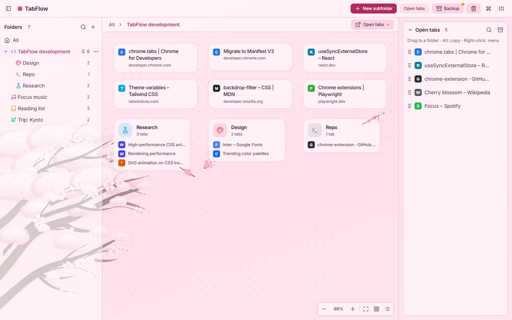
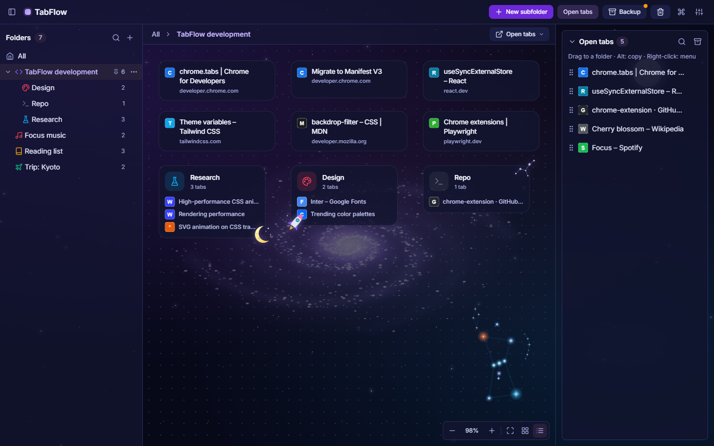
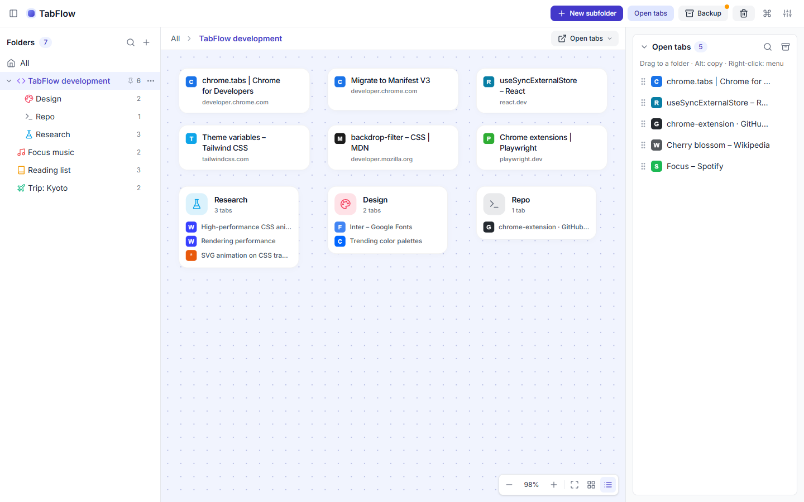
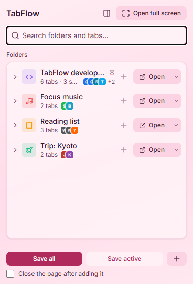
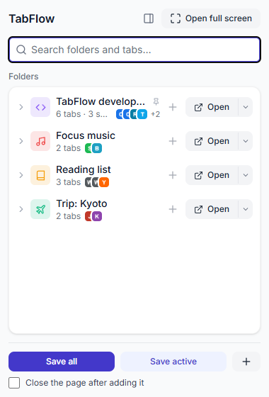

# TabFlow

**English** · [Türkçe](README.tr.md)

Save your tabs into folders and a free-form canvas, close them, and restore them in seconds. A Chrome (Manifest V3) extension.



| Space (dark) | Default (light) |
| --- | --- |
|  |  |

| Popup (Sakura) | Popup (default) |
| --- | --- |
|  |  |

## Features

### Saving and restoring
- **Popup:** save all open tabs, or just the active page, to a folder in one click. Search folders, expand nested ones, and reopen tabs one by one or together with their subfolders. If the active page is already saved, the popup shows which folders it is in. Search results are keyboard navigable (`↓` moves into the results, `→`/`←` expand and collapse a folder).
- **Group by site:** when *Save all* is used with *Group into subfolders by site*, two or more tabs from the same site go into a subfolder named after that site.
- **Open options:** open a folder in the current window, together with its subfolders, as a **tab group** with the folder's name and color, or in a **new window**.
- **Context menu:** right-click a page or a link → *Save to TabFlow* → folder. Saves without opening the popup; the toolbar badge shows the result (✓ saved, = already there, ! could not save).
- **Lazy loading:** when many tabs are opened at once, only the first 10 load; the rest load when you click them, so memory use stays low.

### Organizing
- **Full-screen app** (`Alt+Shift+T`, or *Open full screen* in the popup): the folder tree on the left, each folder's own canvas in the middle (drag and drop, zoom, snap to grid), open tabs on the right.
- Nested folders, folder colors and 35 icons.
- **Ordering and pinning:** drag a folder onto the top or bottom edge of another row in the tree to reorder it (`Alt+↑/↓` works too); *Pin to top* keeps frequently used folders first.
- **Multi-select on the canvas:** `Ctrl`/`Shift` + click to select, `Shift` + drag on empty space to select an area, `Ctrl+A` to select all. Drag the selection together, drop it on a folder, move it from the right-click menu, or delete it with `Delete`.
- **Command palette** (`Ctrl+K` / `⌘K`): jump to a folder or run an action.

### Finding
- **Address bar search:** type `tf`, press space, then type your query. Saved tabs and folders appear as suggestions; picking a tab opens the page, picking a folder opens the full-screen app on that folder.
- Search ignores Turkish diacritics in both directions: "istanbul" → "İstanbul", "calisma" → "Çalışma".
- **Side panel:** *Open in side panel* in the popup opens the same interface in the browser's side panel. It stays open while you browse, and the "already saved" indicator updates as you switch tabs. From then on the toolbar icon opens the side panel; *Switch back to popup* in the panel restores the old behavior.

### Look and language
- **Theme packs:** Sakura (a cherry tree swaying in the wind, falling petals) and Space (a rotating galaxy, the Orion constellation, a passing satellite, shooting stars), each in light and dark. The default theme has a choice of accent colors.
- **Turkish and English interface:** *Appearance → Language* (*Automatic* follows the browser). The extension's name, description and shortcut descriptions are translated too.

### Never lose your tabs
- **Trash:** deleted folders (with their subfolders) and tabs are kept for 30 days and can be restored one by one from the full-screen app.
- **Automatic snapshots:** once a day a snapshot of your folders is taken and the last 7 are kept (*Backup* menu). Before restoring one, the current state is snapshotted as well.
- **Automatic backup to disk:** by default a JSON backup is written to `Downloads/TabFlow/` once a week (daily or off, from the *Backup* menu). Chrome deletes all of an extension's data when it is uninstalled; these files survive and can be restored with *Import from backup…*.
- **Import from other tools** (*Backup* menu): paste a OneTab export or a list of URLs, or import a Chrome bookmarks folder with its subfolders (the bookmarks permission is requested only the first time you use this).
- JSON export and import. Importing never deletes existing data; tabs of the same folder are merged.

## Keyboard shortcuts

| Shortcut | What it does |
| --- | --- |
| `Alt+Shift+T` | Open the full-screen app |
| `Alt+Shift+S` | Save the active page to the last used folder |
| `Ctrl+K` (Mac: `⌘K`) | Command palette in the full-screen app: go to a folder or run an action |

Shortcuts can be changed at `chrome://extensions/shortcuts`.

## Installation (development)

```bash
npm install
npm run build        # produces dist/
```

1. Open `chrome://extensions` in Chrome.
2. Turn on **Developer mode** in the top right.
3. **Load unpacked** → select the `dist/` folder.

To rebuild on every change, run `npm run watch`, then reload TabFlow on the extensions page.

On every push and pull request, GitHub Actions runs the type check, lint, unit tests, the build and the end-to-end tests (`.github/workflows/ci.yml`).

The end-to-end tests also cover:

- **Accessibility** (`e2e/a11y.spec.ts`): WCAG 2.1 A/AA checks with axe for every theme pack in light and dark, the popup and dialogs.
- **Visual regression** (`e2e/visual.spec.ts`): screenshots of the theme packs are compared with baselines. Baselines are platform specific; after an intentional visual change, refresh them with `npx playwright test e2e/visual.spec.ts --update-snapshots`. CI (Linux) baselines are produced by the manually triggered *Görsel tabanlar* (visual baselines) workflow and downloaded; until they exist, CI skips these tests.
- **Performance** (`e2e/perf.spec.ts`): startup with a 5,000-tab library, a 2,000-card canvas, and search times.

## Scripts

| Command | What it does |
| --- | --- |
| `npm run build` | Type check + production build (`dist/`) |
| `npm run watch` | Rebuild on change |
| `npm test` | Unit tests (Vitest) |
| `npm run test:e2e` | Build, load the extension into a real Chromium and run the end-to-end tests (Playwright; run `npx playwright install chromium` the first time) |
| `npm run typecheck` | TypeScript type check |
| `npm run lint` | ESLint |
| `npm run decor` | Regenerate the theme decorations (Python 3.10+; see below) |
| `npm run screenshots` | Regenerate the README screenshots (`docs/screenshots/en`, `docs/screenshots/tr`) |

## Permissions

| Permission | Why |
| --- | --- |
| `tabs` | Read the URL and title of open tabs, open and close tabs |
| `storage`, `unlimitedStorage` | Store folders locally (so the quota never fills up with many tabs) |
| `favicon` | Show site icons from Chrome's cache |
| `contextMenus` | The "Save to TabFlow" menu on pages and links |
| `tabGroups` | Open a folder as a tab group with its name and color |
| `downloads` | Write the automatic backup to disk (Downloads/TabFlow) |
| `sidePanel` | Show the interface in the browser's side panel |
| `bookmarks` (optional) | Requested only when importing from bookmarks |

All data stays in this browser (`chrome.storage.local`) and is never sent to any server.

## Backup file

```json
{
  "app": "TabFlow",
  "schemaVersion": 2,
  "exportedAt": "2026-10-27T10:00:00.000Z",
  "workspaces": {
    "<folder-id>": {
      "id": "<folder-id>",
      "name": "Internship",
      "parentId": null,
      "createdAt": 1761559200000,
      "updatedAt": 1761559200000,
      "x": 32,
      "y": 32,
      "tabs": [{ "id": "…", "url": "https://…", "title": "…", "favIconUrl": null, "pinned": false, "x": 32, "y": 32 }]
    }
  }
}
```

Only tabs with `http(s)` URLs are imported; invalid entries are skipped and their number is reported.

## Project structure

```
public/_locales/  manifest strings (name, description, shortcuts)
src/
  background/   service worker (shortcuts, context menu, automatic backup)
  popup/        toolbar popup
  sidepanel/    side panel (the popup interface, kept open across the window)
  app/          full-screen app
  components/   UI components (app/, popup/, ui/)
  hooks/        storage, tab and confirmation hooks
  storage/      React-independent storage (locked writes, backups); also used by the service worker
  store/        UI state (zustand) and cross-window sync
  services/     React-independent tab opening (the popup delegates it to the service worker)
  i18n/         UI strings: tr.ts (source) and en.ts; t('key', { param })
  utils/        pure logic (tree, search, backup, canvas math) and its tests
  styles/       theme variables; card-decor.css and canvas-scene.css are generated
  assets/       theme images (Sakura branches, Space galaxy, Orion)
scripts/decor/  Python scripts that generate the theme decorations
docs/           README screenshots
```

### Theme decorations

The card corner ornaments, the canvas scenery and some images are not written by hand; they are generated by
the scripts in `scripts/decor/`. To change a decoration, edit the script and run `npm run decor`; do not edit the
generated files (`src/styles/card-decor.css`, `src/styles/canvas-scene.css`, `src/assets/uzay-galaksi-*.svg`,
`src/assets/sakura-dal-*.svg`) directly.

- `card_decor.py`: card corner ornaments, the Space star burst, the moon and satellite images (also loaded in the popup).
- `scene.py`: the full-screen canvas scenery (galaxy, Orion, placement of the Sakura branches and petals).
- `orion.py`: builds the Orion constellation from `src/assets/orion-takimyildizi-astronomical.svg`.
- `split_tree.py`: splits `src/assets/sakura-saf-agac-oshima.svg` into upper, middle and lower branch layers.
  To change the cherry tree, update that source file and run `npm run decor`.

Images must not contain animations: Chrome repaints an animated SVG image on every frame, which keeps the CPU
busy (a unit test enforces this). Anything that moves is a separate HTML element animated only with
`transform`/`opacity`.

## Translation

UI strings live in `src/i18n/tr.ts` (source) and `src/i18n/en.ts`. When adding a string, add the same key to both
files; a missing key in the English dictionary is a compile error. English strings that need plurals are small
functions using `plural()`. Manifest strings are in `public/_locales/<lang>/messages.json`.

## License

[MIT](LICENSE). The bundled Inter typeface is distributed under the [SIL Open Font License 1.1](https://openfontlicense.org)
(`@fontsource-variable/inter`).
