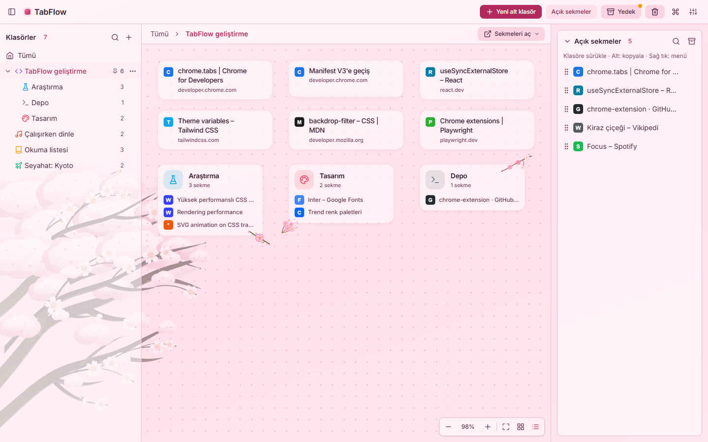
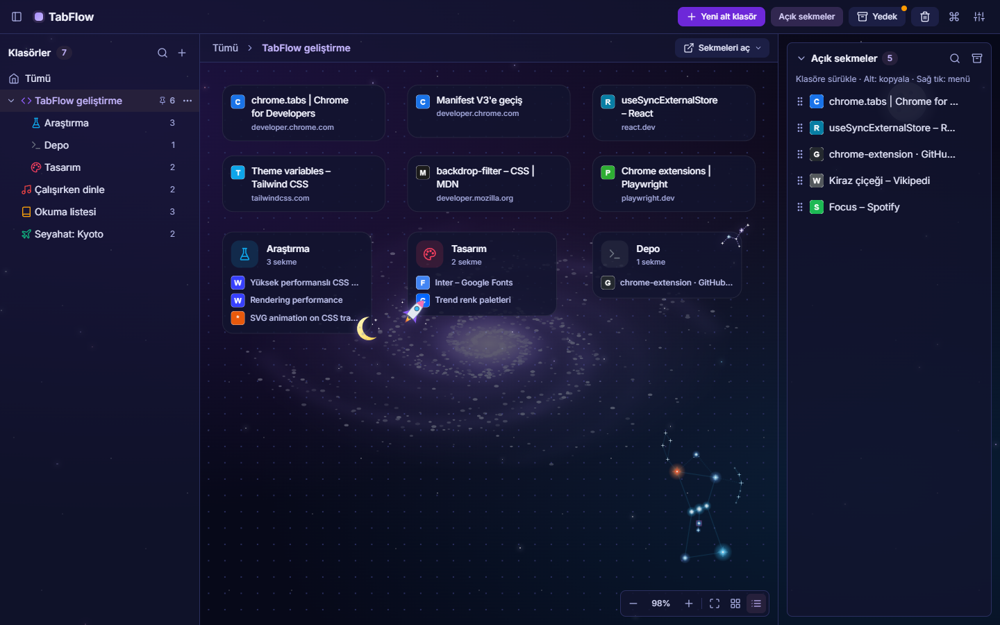
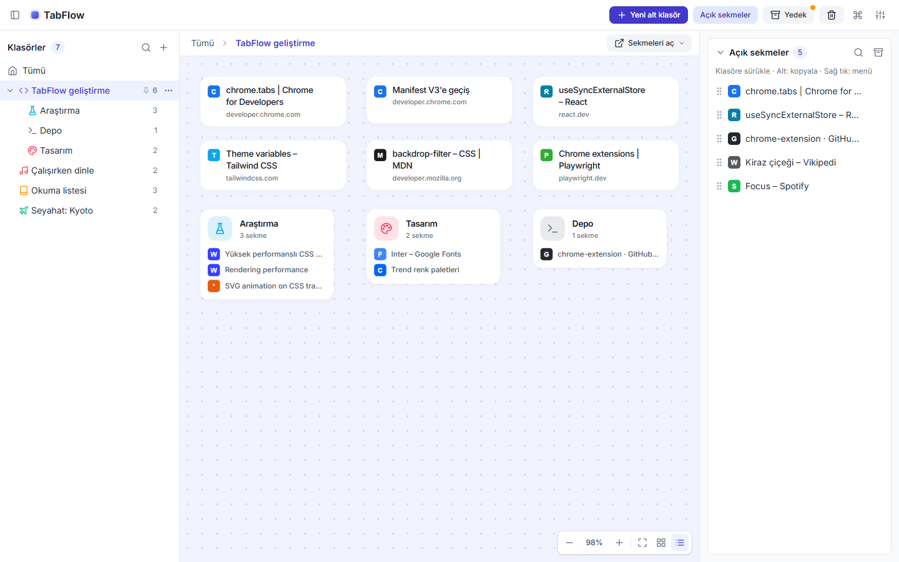
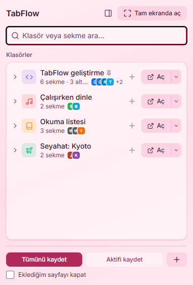
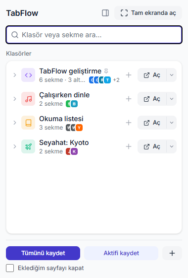

# TabFlow

[English](README.md) · **Türkçe**

Sekmelerini klasörlere ve serbest bir tuvale kaydet, kapat ve saniyeler içinde geri yükle. Chrome (Manifest V3) eklentisi.



| Uzay (koyu) | Varsayılan (açık) |
| --- | --- |
|  |  |

| Popup (Sakura) | Popup (varsayılan) |
| --- | --- |
|  |  |

## Özellikler

- **Popup:** açık sekmelerin tümünü ya da yalnızca aktif sayfayı tek tıkla bir klasöre kaydet; klasörleri ara, iç içe klasörleri aç, sekmeleri tek tek ya da alt klasörleriyle birlikte geri aç.
- **Tam ekran uygulama** (`Alt+Shift+T` ya da popup'taki "Tam ekranda aç"): solda klasör ağacı, ortada her klasörün kendi tuvali (sürükle-bırak, yakınlaştır, ızgaraya diz), sağda açık sekmeler.
- İç içe klasörler, klasör rengi ve 35 simge, tema paketleri: Sakura (rüzgârda salınan kiraz ağacı, düşen yapraklar) ve Uzay (dönen galaksi, Avcı takımyıldızı, geçen uydu, kayan yıldızlar), her biri açık/koyu; varsayılan temada vurgu rengi.
- **Siteye göre gruplama:** *Tümünü kaydet* sırasında “Siteye göre alt klasörlere ayır” seçilirse aynı siteden en az iki sekme o sitenin adıyla bir alt klasöre gider.
- **Açma seçenekleri:** klasörü bu pencerede, alt klasörleriyle birlikte, klasörün adı ve renginde bir **sekme grubu** olarak ya da **yeni pencerede** aç.
- **Sıralama ve sabitleme:** ağaçta bir klasörü başka bir satırın üst/alt kenarına sürükleyerek sırala (`Alt+↑/↓` da olur); "Üste sabitle" ile sık kullanılanları en üstte tut.
- **Tuvalde çoklu seçim:** `Ctrl`/`Shift` + tık ile seç, `Shift` + boş alanda sürükleyerek alan seç, `Ctrl+A` ile tümünü seç. Seçilenleri birlikte sürükle, bir klasöre bırak, sağ tıkla taşı ya da `Delete` ile sil.
- **Türkçe ve İngilizce arayüz:** *Görünüm → Dil* (Otomatik tarayıcının dilini izler). Eklentinin adı, açıklaması ve kısayol açıklamaları da çevrilidir.
- **Yan panel:** popup'taki *Yan panelde aç* aynı arayüzü tarayıcının yan panelinde açar; panel tarama sırasında açık kalır ve sekme değiştikçe 'zaten kayıtlı' göstergesi güncellenir. Bundan sonra araç çubuğu simgesi de yan paneli açar; paneldeki *Açılır pencereye dön* eski davranışa döndürür.
- **Adres çubuğundan arama:** adres çubuğuna `tf` yazıp boşluk bırak, ardından aradığını yaz: kayıtlı sekmeler ve klasörler öneri olarak çıkar. Sekmeyi seçmek sayfayı açar, klasörü seçmek tam ekran uygulamayı o klasörde açar.
- **Popup:** aktif sayfa kayıtlıysa hangi klasörlerde olduğunu gösterir; arama sonuçlarında ok tuşlarıyla gezilir (`↓` sonuçlara iner, `→`/`←` klasörü açar/kapatır).
- Türkçe karakterlere duyarlı arama: "istanbul" → "İstanbul", "calisma" → "Çalışma".
- Çok sayıda sekme açılırken ilk 10'u yüklenir, kalanlar tıklanınca yüklenir (RAM şişmez).
- **Sağ tık menüsü:** bir sayfaya ya da bağlantıya sağ tıkla → *TabFlow'a kaydet* → klasör. Popup'ı açmadan kaydeder; simgedeki rozet sonucu gösterir (✓ kaydedildi, = zaten vardı, ! kaydedilemedi).
- **Çöp kutusu:** silinen klasörler (alt klasörleriyle) ve sekmeler 30 gün saklanır; tam ekran uygulamadan tek tek geri yüklenir.
- **Diske otomatik yedek:** klasörlerin JSON yedeği varsayılan olarak haftada bir `İndirilenler/TabFlow/` klasörüne yazılır (*Yedek* menüsünden günlük yapılabilir ya da kapatılabilir). Eklenti kaldırılırsa Chrome eklentinin tüm verisini siler; bu dosyalar kalır ve *Yedekten içe aktar* ile geri yüklenir.
- **Otomatik yedek:** günde bir kez klasörlerin anlık görüntüsü alınır, son 7'si tutulur (*Yedek* menüsü). Bir yedeğe dönmeden önce o anki hal de yedeklenir.
- **Başka araçlardan içe aktarma** (*Yedek* menüsü): OneTab dışa aktarım metni ya da adres listesi yapıştırılabilir; bir Chrome yer imi klasörü alt klasörleriyle aktarılabilir (yer imleri izni yalnızca bu özellik ilk kullanıldığında istenir).
- JSON yedeği alma ve geri yükleme. Geri yüklemede mevcut veriler silinmez, aynı klasörün sekmeleri birleştirilir.

## Klavye kısayolları

| Kısayol | Ne yapar |
| --- | --- |
| `Alt+Shift+T` | Tam ekran uygulamayı aç |
| `Alt+Shift+S` | Aktif sayfayı son kullanılan klasöre kaydet |
| `Ctrl+K` (Mac: `⌘K`) | Tam ekranda komut paleti: klasöre git ya da bir işlem çalıştır |

Kısayollar `chrome://extensions/shortcuts` adresinden değiştirilebilir.

## Kurulum (geliştirme)

```bash
npm install
npm run build        # dist/ klasörünü üretir
```

1. Chrome'da `chrome://extensions` adresini aç.
2. Sağ üstten **Geliştirici modu**nu aç.
3. **Paketlenmemiş öğe yükle** → `dist/` klasörünü seç.

Değişiklikleri izleyerek derlemek için `npm run watch` kullan; ardından eklentiler sayfasında TabFlow'u yenile.

Her push ve pull request'te GitHub Actions tip kontrolü, lint, birim testleri, derleme ve uçtan uca testleri çalıştırır (`.github/workflows/ci.yml`).

Uçtan uca testler şunları da kapsar:

- **Erişilebilirlik** (`e2e/a11y.spec.ts`): axe ile WCAG 2.1 A/AA denetimi; her tema paketi açık ve koyu, popup ve diyaloglar.
- **Görsel karşılaştırma** (`e2e/visual.spec.ts`): tema paketlerinin ekran görüntüleri tabanlarla karşılaştırılır. Tabanlar platforma özgüdür; bilerek yapılan bir görünüm değişikliğinden sonra `npx playwright test e2e/visual.spec.ts --update-snapshots` ile yenilenir. CI (Linux) tabanları elle çalıştırılan *Görsel tabanlar* iş akışıyla üretilip indirilir; bu tabanlar yokken CI bu testleri atlar.
- **Performans** (`e2e/perf.spec.ts`): 5000 sekmelik kitaplıkta açılış, 2000 kartlık tuval ve arama süreleri.

## Komutlar

| Komut | Ne yapar |
| --- | --- |
| `npm run build` | Tip kontrolü + üretim derlemesi (`dist/`) |
| `npm run watch` | Değişiklikte yeniden derler |
| `npm test` | Birim testleri (Vitest) |
| `npm run test:e2e` | Derleyip eklentiyi gerçek Chromium'a yükleyerek uçtan uca testleri çalıştırır (Playwright; ilk seferde `npx playwright install chromium`) |
| `npm run typecheck` | TypeScript tip kontrolü |
| `npm run lint` | ESLint |
| `npm run decor` | Tema süslerini yeniden üretir (Python 3.10+; ayrıntı aşağıda) |
| `npm run screenshots` | README ekran görüntülerini yeniden üretir (`docs/screenshots/tr/`) |

## İzinler

| İzin | Neden |
| --- | --- |
| `tabs` | Açık sekmelerin adresini/başlığını okumak, sekme açmak ve kapatmak |
| `storage`, `unlimitedStorage` | Klasörleri yerel olarak saklamak (çok sayıda sekmede kota dolmasın) |
| `favicon` | Site simgelerini Chrome'un önbelleğinden göstermek |
| `contextMenus` | Sayfa ve bağlantılarda "TabFlow'a kaydet" menüsü |
| `tabGroups` | Klasörü adı ve rengiyle bir sekme grubu olarak açmak |
| `downloads` | Otomatik yedeği diske (İndirilenler/TabFlow) yazmak |
| `sidePanel` | Arayüzü tarayıcının yan panelinde açmak |
| `bookmarks` (isteğe bağlı) | Yer imlerinden içe aktarırken, yalnızca o an istenir |

Veriler yalnızca bu tarayıcıda (`chrome.storage.local`) tutulur; hiçbir sunucuya gönderilmez.

## Yedek dosyası

```json
{
  "app": "TabFlow",
  "schemaVersion": 2,
  "exportedAt": "2026-10-27T10:00:00.000Z",
  "workspaces": {
    "<klasör-id>": {
      "id": "<klasör-id>",
      "name": "Staj",
      "parentId": null,
      "createdAt": 1761559200000,
      "updatedAt": 1761559200000,
      "x": 32,
      "y": 32,
      "tabs": [{ "id": "…", "url": "https://…", "title": "…", "favIconUrl": null, "pinned": false, "x": 32, "y": 32 }]
    }
  }
}
```

İçe aktarmada yalnızca `http(s)` adresli sekmeler alınır; geçersiz öğeler atlanır ve sayısı bildirilir.

## Proje yapısı

```
public/_locales/  manifest metinleri (ad, açıklama, kısayollar)
src/
  background/   service worker (kısayollar, sağ tık menüsü, otomatik yedek)
  popup/        araç çubuğu açılır penceresi
  sidepanel/    yan panel (popup arayüzü, pencere boyunca)
  app/          tam ekran uygulama
  components/   arayüz bileşenleri (app/, popup/, ui/)
  hooks/        depolama, sekme ve onay kancaları
  storage/      React'ten bağımsız depolama (kilitli yazma, yedekler); service worker da kullanır
  store/        arayüz durumu (zustand) ve pencereler arası eşitleme
  services/     React'ten bağımsız sekme açma (popup bunu service worker'a yaptırır)
  i18n/         arayüz metinleri: tr.ts (kaynak) ve en.ts; t('anahtar', { parametre })
  utils/        saf mantık (ağaç, arama, yedek, tuval matematiği) ve testleri
  styles/       tema değişkenleri; card-decor.css ve canvas-scene.css üretilmiş dosyalardır
  assets/       tema görselleri (Sakura dalı, Uzay galaksisi, Avcı)
scripts/decor/  tema süslerini üreten Python betikleri
docs/           README ekran görüntüleri
```

### Tema süsleri

Kart köşe süsleri, tuval manzarası ve bazı görseller elle değil, `scripts/decor/` altındaki betiklerle
üretilir. Bir süsü değiştirmek için betiği düzenleyip `npm run decor` çalıştırın; üretilen dosyaları
(`src/styles/card-decor.css`, `src/styles/canvas-scene.css`, `src/assets/uzay-galaksi-*.svg`,
`src/assets/sakura-dal-*.svg`) elle düzenlemeyin.

- `card_decor.py`: kart köşe süsleri, Uzay'ın yıldız saçılması, ay ve uydu görselleri (popup'ta da yüklenir).
- `scene.py`: tam ekran tuval manzarası (galaksi, Avcı takımyıldızı, Sakura dalları ve yaprakların yerleşimi).
- `orion.py`: Avcı takımyıldızını `src/assets/orion-takimyildizi-astronomical.svg` dosyasından üretir.
- `split_tree.py`: `src/assets/sakura-saf-agac-oshima.svg` dosyasını üst/orta/alt dal parçalarına böler.
  Kiraz ağacını değiştirmek için bu kaynak dosyayı güncelleyip `npm run decor` çalıştırın.

Görsellerin içinde animasyon olmamalıdır: Chrome, animasyonlu bir SVG görselini her karede yeniden çizer
ve sürekli işlemci yükü oluşturur (bir birim testi bunu denetler). Hareket gerekiyorsa ayrı HTML öğeleri
yalnızca `transform`/`opacity` ile canlandırılır.

## Çeviri

Arayüz metinleri `src/i18n/tr.ts` (kaynak) ve `src/i18n/en.ts` dosyalarındadır. Yeni bir metin eklerken iki dosyaya
da aynı anahtarı ekle; İngilizce sözlükte eksik anahtar derleme hatası verir. Çoğul gereken İngilizce metinler
`plural()` kullanan küçük fonksiyonlardır. Manifest metinleri `public/_locales/<dil>/messages.json` içindedir.

## Lisans

[MIT](LICENSE). Pakete gömülen Inter yazı tipi [SIL Open Font License 1.1](https://openfontlicense.org) ile dağıtılır
(`@fontsource-variable/inter`).
